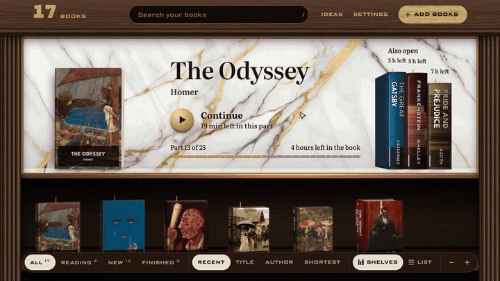

# East Room

**I couldn't finish a book, so I built a library.**

Open a book and follow the moving highlight at your own pace. When you return, pick up where you stopped, in the author's own words.

<picture>
  <source media="(prefers-reduced-motion: reduce)" srcset="docs/media/library.png">
  
</picture>

**[Open the library](https://eastroom.intesarjawad.com)**. Read a classic or add an EPUB of your own; your browser reads the file on your computer without uploading it.

Use an EPUB without copy protection for the browser trial. Scanned PDFs do not support the moving text highlight.

Install it on a Mac or on Linux. Paste this into Terminal:

```sh
curl -LsSf https://raw.githubusercontent.com/intesarjawad/eastroom/main/install.sh | sh
```

On Windows, paste this into PowerShell:

```powershell
irm https://raw.githubusercontent.com/intesarjawad/eastroom/main/install.ps1 | iex
```

East Room opens in your browser. Drop a book file on the page and start reading.

## What it does

I built East Room because I have ADHD and a shelf of books I never finished. Summaries were not the answer: I wanted the actual book. So East Room does one thing. It takes a book file and walks you through every word of it.

- **Your books stand in a bookcase.** Every book is an object on a walnut shelf with its own cover and a lettered spine. The one you are in is named on a slab of marble at the top, one press from the line you stopped on.
- **A highlighter moves through the text for you.** You set the pace in words a minute. Read words step back, the page follows the line, and your eyes always know where to be.
- **The book is cut where the author cut it.** Chapters and the author's own headings become short parts with a time on each, so there is always a finish line a few minutes away.
- **Each part ends with the next one already in view.** You see the next heading, its first lines, and how long it takes. Keep going with one key, or stop there.
- **Nothing is added to the text.** No summaries, no generated questions. The only extras are lines you chose to keep.
- **Your place is always saved.** Close the tab mid-sentence and the library opens on the exact line, with the time left in the book.
- **It follows you to your phone and tablet.** Each device keeps what you are reading, works without a connection, and passes your place on when it next reaches your computer.
- **Every part can have a picture.** If you connect an AI tool, East Room asks it to name a painting or an old photograph for each part, and fetches the ones that are in the public domain from Wikimedia Commons. A model never draws anything.
- **A voice is optional.** Your computer can narrate the books you are reading, starting at your place. One button turns the voice on or off and the highlighter follows it.

## Start in three steps

You do not need to know what a terminal is. You need a Mac, a Windows PC or a Linux computer, and an internet connection for the install.

**1. Open the window you paste into.**

- Mac: press Command and Space, type `Terminal`, press Return.
- Windows: press the Windows key, type `PowerShell`, press Enter.
- Linux: open your terminal.

**2. Paste the line for your computer from the top of this page and press Return.**

It asks for no password. It puts three things in your own user folder: uv (a small tool that fetches Python for East Room and keeps it apart from everything else), East Room itself, and an East Room icon. The whole script is short enough to read first: [install.sh](install.sh), [install.ps1](install.ps1).

**3. East Room opens in your browser. Drop a book on the page.**

An EPUB, a PDF, a comic archive (CBZ) or a text file. If you have no book file at hand, [Standard Ebooks](https://standardebooks.org/) and [Project Gutenberg](https://www.gutenberg.org/) give away thousands of classics, well made and free. Download one as EPUB and drop it in.

After that, East Room is an app like any other:

| | |
|---|---|
| Open it again | Mac: East Room in your Applications folder, or Command and Space and type East Room. Windows: the Windows key, then type East Room. Linux: your app menu. |
| Add a book | Drop its file on the page, or press Add books. |
| Update it | Paste the install line again. Your books and your places stay. |
| Remove it | Mac and Linux: `curl -LsSf https://raw.githubusercontent.com/intesarjawad/eastroom/main/install.sh \| sh -s -- --uninstall` <br> Windows: `$env:EASTROOM_UNINSTALL = 1; irm https://raw.githubusercontent.com/intesarjawad/eastroom/main/install.ps1 \| iex` <br> Your books stay in the `.eastroom` folder of your user folder until you delete it. |

If the install stops, it says what happened and what to do next. If that does not get you through, [open an issue](https://github.com/intesarjawad/eastroom/issues) and paste what it said.

## A library of hundreds

<picture>
  <source media="(prefers-reduced-motion: reduce)" srcset="docs/media/shelves.png">
  
</picture>

The bookcase is built for the day you have hundreds of books. Spines carry the book's own colours and its short name. Stop on one and it turns its cover to you. Type to find a book, or order the shelves by title, author, what you read last, or what is shortest to finish.

The books in these pictures are [Standard Ebooks](https://standardebooks.org/) editions. Their texts and cover paintings are in the public domain. The [browser demo](https://eastroom.intesarjawad.com) has 17 of these classics on its shelves and needs nothing installed. The paintings behind The Odyssey's parts are public-domain files from Wikimedia Commons, found by East Room's own pictures step.

## On your phone and tablet

Your phone opens the same East Room from your computer and keeps a copy of what you are reading, so it works on a train with no signal. Your place and your kept lines travel back when the phone next reaches your computer.

East Room has no accounts and no cloud, so the two devices meet over a private network that you set up once. I use [Tailscale](https://tailscale.com/), which is free for personal use. [docs/setup.md](docs/setup.md) walks through it, and through turning on narration.

## Keys

| Key | Action |
|---|---|
| Space | play or pause |
| Left, Right | previous or next sentence |
| Up, Down | faster or slower, 10 words a minute at a time |
| K | keep the current line |
| C | contents, kept lines, text size |
| Esc | close a panel, or go back to the library |

Click any word to read from there.

## Questions people ask

**Is it free?** Yes. East Room is open source under the MIT licence. There is no account, no subscription and nothing to pay for.

**Do my books go anywhere?** No. East Room runs on your computer and the page loads nothing from outside. Three things reach out, and only when you ask for them. Turning on narration downloads its voice the first time. If you choose to connect an AI tool in Settings, the text you ask it to work on goes to that tool. With a tool connected, East Room also looks for pictures on Wikimedia Commons: the names of the pictures it searches for go there, and a switch in Settings turns that off. The demo site follows the same rule. A file you add there is read by your own browser and kept in that browser's storage. No server receives it, and the site has none that could.

**Which files can it read?** EPUB, PDF, CBZ comics, plain text and Markdown. For Kindle formats (MOBI, AZW3), convert the file with [Calibre](https://calibre-ebook.com/) first. Books with copy protection (DRM) cannot be opened.

**Where are my books kept?** In a folder named `.eastroom` in your user folder, as plain files you can copy or back up. Your place and your kept lines sit beside them.

**Does it need the internet?** Only for the install. After that it works with the network off.

**How do I stop it?** On Windows, close the small East Room window in the taskbar. On a Mac it runs quietly in the background until the computer restarts. In Settings, under Devices, you can make it start with the computer.

## How it compares

Speechify reads your books on its servers for a subscription ([speechify.com/pricing](https://speechify.com/pricing/)). It has more voices, and they are ready the moment you open a book. East Room is free, keeps the book on your machine, and is built around finishing a whole book rather than listening faster.

## Limits

- A scanned PDF is shown page by page. Its text is not recognised, so the highlighter and the voices cannot follow it.
- Comics and picture books are read page by page with a light that moves from panel to panel. Panels are found from the gutters, which fails on pages without clear gutters.
- Narration is English only for now, and it is made ahead of you at your computer rather than on demand. The second voice needs a Mac with an Apple chip.
- On iPhone the silent switch mutes the device's own voice. Recorded narration is not affected.
- Reading on a phone needs a private network such as Tailscale between the phone and your computer.
- Books converted without heading tags get their chapter titles from a heuristic, which can be wrong.
- The Windows installer is tested by an automated run on every change, not yet by me on a real PC.

## For developers

East Room is a Python package with no dependencies beyond the standard library, and a front end with no build step. It needs Python 3.11 or newer.

```sh
uvx --from git+https://github.com/intesarjawad/eastroom eastroom yourbook.epub   # run it once, without installing
uv tool install "eastroom[pdf] @ git+https://github.com/intesarjawad/eastroom"   # what the installer does
```

```sh
git clone https://github.com/intesarjawad/eastroom && cd eastroom
make setup    # the pinned linter and type checker
make check    # format, lint, types, tests, prose rules
make demo     # the library with one public-domain book
```

- The server listens on `127.0.0.1` only. A book is a folder of JSON files in `~/.eastroom`; your place and kept lines are one small JSON file per device beside it.
- No AI in the import. Chapters and parts come from the book's own structure, so a book costs nothing to add.
- Settings has a workshop for the whole library: key lines for each part in the author's own words, pictures from Wikimedia Commons, recorded voice, reading a file again, and removing things with seven days to change your mind. Three optional jobs can use a model of your choice: matching each spine's lettering to its cover, choosing key lines, and naming a picture to look for. Pick an AI tool you are signed in to on that computer (Claude Code, Codex, agy, OpenCode) or any server that speaks the OpenAI chat API, such as Ollama, LM Studio or OpenRouter.

The design of the code is in [docs/architecture.md](docs/architecture.md), the design of the room in [DESIGN.md](DESIGN.md), and the decisions behind both in [docs/adr](docs/adr). Contributions are welcome: see [CONTRIBUTING.md](CONTRIBUTING.md).

## Licence

MIT for East Room's own code. The bundled typefaces, libraries, sounds and pictures keep their own terms, listed in [THIRD-PARTY.md](THIRD-PARTY.md). GSAP in particular is free to use but is not open source.
