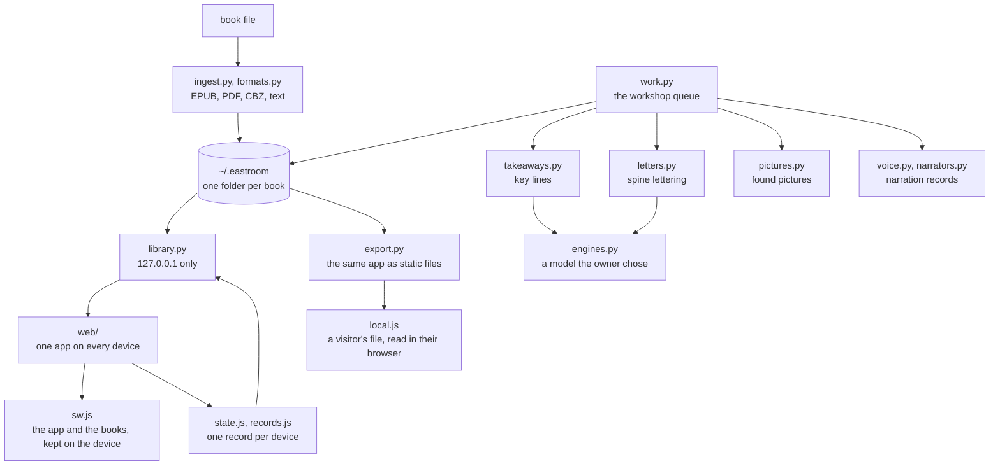

# Architecture

East Room is one computer that owns the books (Home) and one web app that every device runs. Home is a small Python process. The app is plain files with no build step.



| Module | What it does |
|---|---|
| `__main__.py` | the `eastroom` command: add the named books, start Home, open the browser |
| `ingest.py` | turns an EPUB into chapters and blocks, with the standard library only |
| `formats.py` | the other formats: plain text, comics in a zip, PDF |
| `library.py` | the local server: books, the app's files, each device's record |
| `work.py` | the workshop: jobs for a book after it is in, one at a time, kept across a restart |
| `takeaways.py` | key lines of a part in the author's exact words, ranked without a model |
| `letters.py` | asks a vision model once what a cover's lettering looks like, for the spine |
| `pictures.py` | asks a model to name a picture for each part, fetches the free ones from Wikimedia Commons, and works out each part's two colours from its picture |
| `engines.py` | one question to a model the owner chose: a terminal tool or an OpenAI-compatible server |
| `voice.py`, `narrators.py` | narration records beside the chapters, and the voices that make them |
| `home.py` | what this machine can do: which engines are present, starting at login |
| `export.py` | writes a library as plain files for a static host |

In the app (`eastroom/web`):

| File | What it does |
|---|---|
| `index.html`, `library.js`, `shelf.js` | the library: the bookcase, the slab, the shelves drawn in one WebGL pass |
| `read.html`, `reader.js`, `world.js` | the reader for flowing text, and the picture behind it |
| `pages.html`, `pages.js`, `panels.js` | the reader for books of pages, panel by panel |
| `settings.*`, `ideas.*` | the rooms off the library |
| `sw.js`, `hold.js` | what the device keeps so reading does not need Home |
| `local.js` | on a published copy: reads a visitor's file in their own browser, with the package's Python on Pyodide |
| `state.js`, `records.js` | this device's record, and how many devices' records become one view |
| `voice.js`, `sound.js` | the device's own voice, and the interface sounds |
| `colour.js`, `cover.js` | a book's colours, and its cover as a lit object |

## Routes

| Route | What |
|---|---|
| `GET api/library` | every book with its chapters; each chapter has a stamp `v` and the stamps of its narration records |
| `GET api/book/<book>/<chapter>` | one chapter's text |
| `GET api/voice/<book>/<voice>/<chapter>` | one narration record |
| `GET media/<book>/...` | covers, pictures, audio (byte ranges supported) |
| `GET api/state` | every device's record for every book |
| `PUT api/state/<book>/<device>` | a device stores its own record, whole |
| `POST api/import?name=` | add a book file |
| `POST api/work`, `api/work/cancel` | queue a workshop job for one book or for all, or cancel one |
| `POST api/remove`, `api/restore`, `api/purge` | take a book or one of its parts out, bring it back within seven days, or delete it for good |
| `POST api/engines/key`, `api/engines/try` | store the key of a server the owner added, or ask an engine one test question |
| `POST api/login` | start Home when the owner logs in, or stop doing so |

The Settings page reads a few more routes for what the workshop is doing; `eastroom/library.py` holds the whole list.

A request that carries the file's current stamp (`?v=`) is answered with a one-year immutable cache header, because that address will never mean anything else. A request with an older stamp gets today's file marked `no-store`, so no device keeps new bytes under an old name. Everything else is `no-cache`. Files that come out of books are sent with `Content-Security-Policy: sandbox` and `nosniff`: nothing inside an EPUB can run as a page of the app.

## Decisions

**Standard library only at Home.** An EPUB is a zip of XHTML, and `zipfile`, `html.parser` and `http.server` cover it. The narrators are optional extras in a separate process; reading and importing never import them.

**No model in the import.** `ingest.py` reads structure the book already has. Chapters start at the shallowest heading level used at least three times. Books with no heading tags fall back to a rule: a short unpunctuated line before a paragraph is a heading. The same file added twice is one book (its hash is kept in `source`); two different files with the same title are two books. Files with copy protection are refused with a plain message.

**Parts come from the author.** Inside a chapter, each heading starts a part. A stretch longer than about 1,700 words is cut at a paragraph end and named by its own first words.

**Each device is the only writer of its record.** See [ADR 1](adr/0001-one-record-per-device.md). The app reads from the device first and treats Home as something it meets now and then: a change counts as sent only when Home has stored it, and until then the library says how many books are waiting.

**The device keeps what you are reading.** The service worker stores the app and every stamped address it has fetched. The app asks for the text of all unfinished books and for narration of the current part and the next two. Unstamped requests go to Home first with a 1.5 second limit and fall back to the stored copy, so a sleeping Home never blocks a page.

**Narration is a record beside the chapter.** See [ADR 3](adr/0003-narration-beside-chapters.md). `eastroom --voice` looks at every device's record and narrates one chapter at a time, checking the order again after each: first the chapter being read in every book, then the next one in every book, and so on to the end. Every book in progress has a voice a little ahead of its reader before any book is narrated to its end. A record whose chapter text has changed is removed with its audio.

**The voice you hear is the best one a part has.** Storyteller, then narration the book came with, then the plain voice, then the device's own speech engine, then the light alone. The light follows sentence times from the record, or word events from the device voice.

**Home is private by construction.** It binds to loopback. Writes are refused unless the page's origin is local or was named with `--origin`. See [ADR 2](adr/0002-private-network-not-pairing.md). Every served path is resolved and checked against its root.

**A book's colours come from the book.** If Home holds a colour set made from the book's pictures (`worlds.json`, written by `pictures.py`), the app uses it. Otherwise the hues step round the colour wheel from the cover's strongest hue, one step per chapter.

**The same app runs without Home.** `eastroom --export DIR` writes files at the paths Home would answer, so the result can go on any static host. Records then stay on the device. A visitor can still add a book there: a worker (`web/local.js`) runs the package's own importer in their browser and the service worker answers for the book from the browser's storage. See [ADR 9](adr/0009-a-published-copy-reads-files-in-the-browser.md).

## Files

Chapter:

```json
{"id": "c003", "title": "The Second Book",
 "blocks": [{"id": "b0001", "k": "p", "t": "The author's words."}]}
```

`k` is `h` (heading), `p` (paragraph), `q` (quotation) or `a` (attribution).

Narration record:

```json
{"voice": "plain", "chapter": "c003", "text": "9f2c61d0a4b7e385",
 "audio": [{"src": "voice/plain/c003-9f2c61d0-01.m4a",
            "sentences": [{"b": "b0001", "s": 0.0, "e": 2.4, "t": "The author's words."}]}]}
```

`text` is a hash of the chapter's blocks. `s` and `e` are seconds inside that audio file.

Device record:

```json
{"device": "k3v9x2ab", "name": "iPhone", "rev": 42, "seen": 1794508325400,
 "place": {"ch": "c003", "w": 4151, "t": 1794508325400, "exact": "the words at the place", "prefix": "", "suffix": ""},
 "kept": {"c003:b0007:2": {"t": 1794508000000, "exact": "A line worth keeping."}},
 "done": {"c001": {"t": 1794400000000, "v": true}},
 "days": {"2026-11-12": 1260}}
```

Times are milliseconds since 1970, on Home's clock as the device last heard it. `rev` counts the device's changes; Home ignores a save whose `rev` is lower than the one it holds. `days` holds seconds read per day. A kept line that was removed stays as `{"t": ..., "gone": true}` so the removal reaches the other devices.
